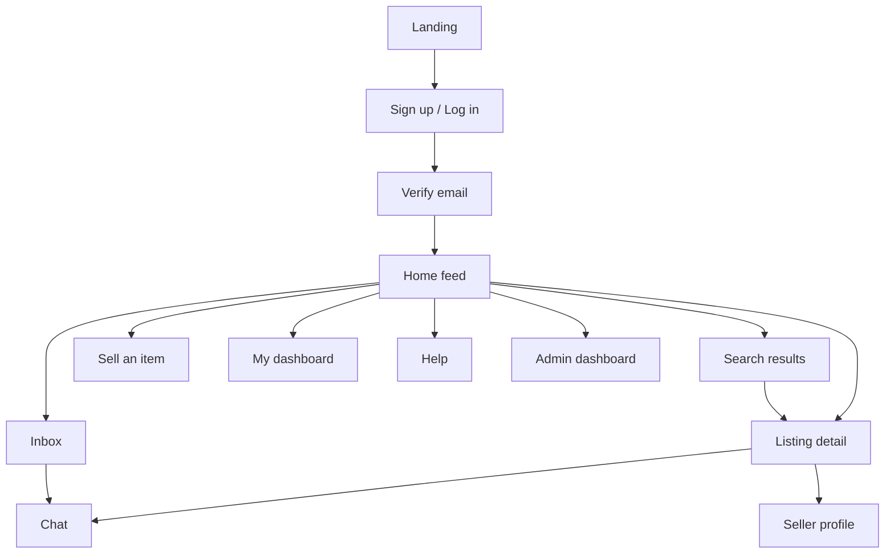
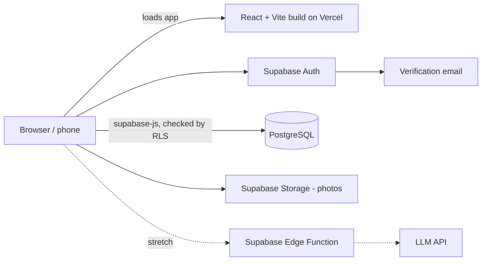
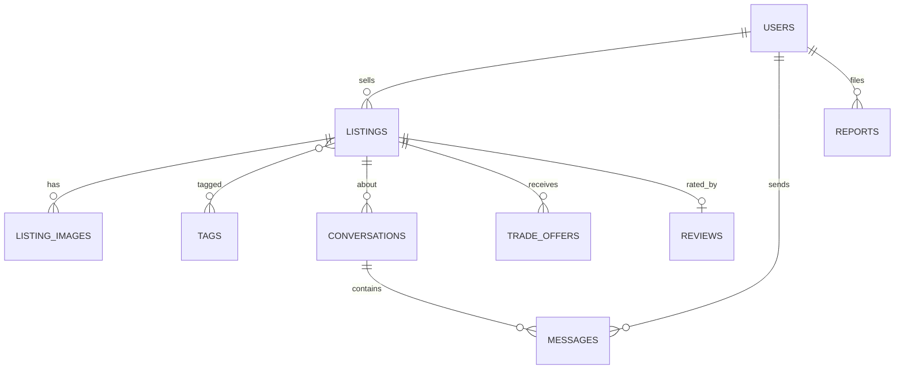

Contents

1. [Overview](#overview)
2. [Scope](#scope)
3. [Users & roles](#users)
4. [Functional requirements](#functional)
5. [Non-functional requirements](#nonfunctional)
6. [Design](#design)
7. [Architecture & data](#architecture)
8. [Team roles](#team)
9. [6-week timeline](#timeline)
10. [Testing & done](#testing)
11. [Risks](#risks)
12. [Open decisions](#decisions)

Free for students

# Northeastern Student Marketplace

Project document · Working title: *HuskyMarket* (name TBD)

A campus-only web app where verified Northeastern students and alumni buy, sell, and trade items in person, with built-in chat and seller ratings.

- Textbooks
- Dorm furniture
- Electronics
- Mini fridges
- Clothes
- Tickets

Platform

Responsive web app

Exchange

In person only

Payment

Seller's choice

Timeline

6 weeks

## 1 Overview

### Problem

Students buy and sell the same things every semester (textbooks, furniture, tickets) through scattered group chats and public sites where you can't tell whether the other person is actually a student. Listings are hard to search, and useful items get thrown out at move-out.

### Solution

A marketplace limited to people with a Northeastern email. Sellers post listings with photos, tags, and their preferred payment method or a trade. Buyers browse cards, filter by what they need, message the seller, and meet in person. After the exchange, buyers rate the seller so trust builds over time.

### Objectives for the 6-week build

- A deployed app where a user can complete the full loop: sign up with a Northeastern email → verify → post a listing → find a listing → message the seller → mark sold → leave a rating.
- An admin can review reported content and remove it.
- One AI feature (support chatbot) if the core loop is finished by end of week 4.

## 2 Scope

Requirements use three priority levels: Must ships in 6 weeks no matter what, Should ships if on schedule, Could only if time is left in week 5–6.

| In scope | Stretch (if time) | Out of scope |
| --- | --- | --- |
| Northeastern email sign-up + verification   Profiles   Listings with photos and tags   Card feed + detail view   Search and filters   Buyer–seller chat   Payment options + basic trade offers   Seller ratings   Seller dashboard   Admin dashboard (reports) | AI support chatbot   Map of listings by campus area   AI natural-language search   Saved listings | In-app payments / Stripe   Shipping   Real-time websockets (polling instead)   Email notifications beyond verification   Other universities   Native mobile app |

## 3 Users & roles

| Role | Who | Permissions |
| --- | --- | --- |
| **Visitor** | Not logged in | Landing page, sign up, log in, help page. |
| **Member** | Verified student or alumni | Browse, search, post, chat, offer trades, rate, report. |
| **Admin** | Team members | All member permissions plus reports queue, remove listings, suspend users, view stats. |

### Personas

- **Maya, first-year.** Needs a mini fridge and two textbooks; wants to know the seller is a real student.
- **Jordan, graduating senior.** Has two weeks to sell a desk, monitor, and couch; happy to take Venmo or a trade.
- **Priya, alum.** Selling concert tickets she can't use; trusts the Northeastern community over resale sites.

## 4 Functional requirements

What the system must do, grouped by component. IDs (e.g. F3.2) can be used as ticket names on your project board.

### F1 · Accounts & verification

Only Northeastern community members can get in.

| ID | Requirement | Priority |
| --- | --- | --- |
| F1.1 | Users can sign up only with an email ending in `@northeastern.edu`. Other domains get the message "Use your Northeastern email to sign up." | Must |
| F1.2 | The system emails a verification link that expires after 24 hours, with a "Resend link" option. | Must |
| F1.3 | Unverified accounts cannot browse listings, post, or message. | Must |
| F1.4 | Users can log in and log out; sessions last 7 days. | Must |
| F1.5 | Users can reset a forgotten password by email. | Should |

### F2 · Profiles

Who you're dealing with.

| ID | Requirement | Priority |
| --- | --- | --- |
| F2.1 | Users set a display name, photo, grad year, and whether they're a student or alum. | Must |
| F2.2 | Public profile shows active listings, average rating, number of reviews, and member-since date. Email is never shown. | Must |
| F2.3 | Users can edit their profile and delete their account. | Should |

### F3 · Listings

Creating and managing items for sale or trade.

| ID | Requirement | Priority |
| --- | --- | --- |
| F3.1 | Users create a listing with: title, description, category, price (or Free / Trade only), condition, 1–6 photos, up to 5 tags, campus area, accepted payment methods, and "open to trades". | Must |
| F3.2 | Categories: Textbooks, Furniture, Electronics, Appliances, Clothing, Tickets, Dorm essentials, Other. | Must |
| F3.3 | Extra fields appear by category: size (Clothing), course code (Textbooks), event date (Tickets). | Should |
| F3.4 | Sellers can edit and delete their own listings. | Must |
| F3.5 | Each listing has a status: Active, Pending, or Sold. Only Active listings appear in the feed. | Must |
| F3.6 | Photos are limited to 5 MB each and resized before storage. | Must |

### F4 · Home feed & listing detail

Browsing with cards that open into a bigger view.

| ID | Requirement | Priority |
| --- | --- | --- |
| F4.1 | Home page shows a grid of listing cards, newest first. Each card shows photo, title, price, condition, campus area, and time posted. | Must |
| F4.2 | Clicking a card opens the detail view: photo gallery, full description, tags, payment methods, seller name and rating, and buttons for "Message seller", "Offer a trade", and "Report". | Must |
| F4.3 | The feed loads 24 listings at a time with a "Load more" button. | Must |
| F4.4 | Each listing has its own shareable URL (`/listings/[id]`). | Should |

### F5 · Search, filters & tags

Finding the right item fast.

| ID | Requirement | Priority |
| --- | --- | --- |
| F5.1 | Keyword search across title, description, and tags. | Must |
| F5.2 | Filters: category, price range, condition, size, open to trades. Filters combine. | Must |
| F5.3 | Sort by newest, price low to high, and price high to low. | Must |
| F5.4 | Clicking a tag on a card or detail view filters the feed by that tag. | Should |
| F5.5 | AI search: plain-English queries ("desk under $40") are turned into filters, shown as chips the user can remove. | Could |

### F6 · Chat

Coordinating price, time, and meetup spot.

| ID | Requirement | Priority |
| --- | --- | --- |
| F6.1 | "Message seller" opens a conversation tied to that listing. One conversation per buyer per listing. | Must |
| F6.2 | Inbox lists conversations with the listing photo, other person's name, last message, and an unread dot. | Must |
| F6.3 | New messages appear within 5 seconds without refreshing (polling). | Must |
| F6.4 | Users can report or block someone from a conversation. | Should |

### F7 · Payment options & trading

Money never moves through the app. The seller decides how to get paid.

| ID | Requirement | Priority |
| --- | --- | --- |
| F7.1 | Sellers choose accepted methods per listing: Cash, Venmo, Zelle, Trade. These show on the card and detail view. | Must |
| F7.2 | Sellers mark a listing Sold and select the buyer from people who messaged them. | Must |
| F7.3 | On listings open to trades, buyers send a trade offer: one of their listings or a written description, plus optional cash. | Should |
| F7.4 | Sellers accept or decline trade offers; accepting sets the listing to Pending. | Should |

### F8 · Seller ratings

Trust that builds with every deal.

| ID | Requirement | Priority |
| --- | --- | --- |
| F8.1 | After a listing is marked Sold to them, the buyer can rate the seller 1–5 stars with an optional comment. | Must |
| F8.2 | Only one rating per sale; users can't rate themselves or people they didn't buy from. | Must |
| F8.3 | Average rating and review count show on the seller's profile and listing detail view. | Must |

### F9 · Seller dashboard

Managing your own listings.

| ID | Requirement | Priority |
| --- | --- | --- |
| F9.1 | Shows the user's listings in tabs: Active, Pending, Sold. | Must |
| F9.2 | Quick actions per listing: Edit, Mark sold, Delete. | Must |
| F9.3 | Shows incoming trade offers with Accept / Decline. | Should |

### F10 · Admin dashboard

Keeping the marketplace safe.

| ID | Requirement | Priority |
| --- | --- | --- |
| F10.1 | Members can report a listing or user with a reason (scam, prohibited item, offensive, other). | Must |
| F10.2 | Admins see a reports queue and can dismiss, remove the listing, or suspend the user. | Must |
| F10.3 | Admin overview shows totals: users, active listings, sold listings, open reports. | Should |
| F10.4 | Admin data is blocked for non-admins by RLS policies in the database, not just hidden in the UI. | Must |

### F11 · Stretch features

Only after F1–F10 Must items are done.

| ID | Requirement | Priority |
| --- | --- | --- |
| F11.1 | AI support chatbot answers questions about how the site works, safety, and prohibited items, using the Help page text as its only source. | Could |
| F11.2 | If the chatbot can't answer, it offers a "Contact an admin" button that creates a report. | Could |
| F11.3 | Map page shows listings pinned to their campus area (never an exact address). | Could |
| F11.4 | Users can save listings and view them on a Saved page. | Could |

## 5 Non-functional requirements

How well the system must work. Each has a way to check it before the demo.

| ID | Category | Requirement | How we verify |
| --- | --- | --- | --- |
| N1 | Performance | Home feed's main content loads in under 2.5 s on a phone over 4G. Images are lazy-loaded. | Lighthouse mobile performance score ≥ 80 |
| N2 | Performance | Search and filter results return in under 1 s with 1,000 listings. | Seed 1,000 listings, time the API |
| N3 | Security | Every table has RLS enabled, with policies that check the session, email verification, and (for edits) that the user owns the row. | Manual tests querying Supabase as the wrong user |
| N4 | Security | Passwords are hashed by Supabase Auth; keys live only in environment variables, and only the publishable key reaches the browser. | Code review; `.env` in `.gitignore` |
| N5 | Security | All input is validated by database constraints (required fields, CHECKs, length limits), with matching form validation in the UI. Sign-up and login are rate-limited by Supabase Auth; message sending is capped in the database. | Send malformed and repeated requests |
| N6 | Privacy | No exact addresses are stored or shown; emails are never displayed publicly. | Review listing and profile pages |
| N7 | Usability | A first-time user can post a listing in under 2 minutes without help. | Hallway test with 3 classmates |
| N8 | Usability | Every list has an empty state that tells the user what to do next; every error says what went wrong and how to fix it. | Design review checklist |
| N9 | Accessibility | Text contrast ≥ 4.5:1, alt text on listing photos, all actions reachable by keyboard, visible focus. | Lighthouse accessibility ≥ 90; keyboard-only run |
| N10 | Compatibility | Works on current Chrome, Safari, Firefox, and Edge; iOS Safari and Android Chrome; screen widths from 360 px. | Test on team members' devices |
| N11 | Reliability | Failed actions don't lose user input (e.g. listing form keeps values on error). Server errors are logged. | Force errors in testing |
| N12 | Maintainability | Oxlint, every PR reviewed by one teammate, schema changes only through migrations, README with setup steps. | CI lint and build check on PRs |
| N13 | Scalability | Schema includes a `universities` table so other schools can be added later; indexes on listing status, category, and created date. | Schema review |
| N14 | Cost | Runs on free tiers (Vercel, Supabase). AI calls capped at 20 per user per day. | Check usage dashboards weekly |

## 6 Design

### Design principles

- **Photos first.** People decide by looking, so cards lead with a large image and the price.
- **Trust is visible.** Verified badge, seller rating, and member-since date appear wherever you see a seller.
- **Phone first.** Design every screen at 375 px wide, then expand for desktop.
- **Plain language.** Buttons say exactly what they do: "Message seller", "Mark as sold", "Post listing".

### Site map

### Key screens (low-fidelity wireframes)

Mobile layouts. On desktop the feed becomes 3–4 columns and the detail view opens as a centered modal.

Logo

Search listings…

☰

All

Books

Furniture

Filters

photo

photo

photo

photo

\+ Sell an item

**Home feed**Search bar, category chips, 2-column card grid, persistent "Sell an item" button.

photo gallery · 1 / 4

Good

Venmo

Trade OK

★ 4.8

description

Message seller

Offer trade

**Listing detail**Gallery, price and title, payment and trade chips, seller with rating, primary action pinned at bottom.

\+ Add photos (1–6)

Title

Category ▾

Condition ▾

$ Price

Free

Trade only

Description

Tags

Cash

Venmo

Zelle

Trade

Post listing

**Sell an item**Single-page form; photos first, category-specific fields appear after choosing a category.

img

View

Is this still available?

Yes! Can meet at Snell tomorrow

3pm works

Type a message…

Send

**Chat**Listing pinned on top, message bubbles, input at bottom; report/block in the header menu.

### Visual design system

#### Color

**Primary red**#C8102E · buttons, links

**Ink**#1C1F26 · text

**Muted**#6B7280 · secondary text

**Surface**#F4F5F7 · page background

**Success**#1E7A4F · verified, sold

**Warning**#B26B00 · pending

Red is reserved for primary actions so the next step is always obvious. Support a dark mode only if time allows.

#### Typography

| Style | Size / weight | Used for |
| --- | --- | --- |
| Page title | 28 px / 700 | Screen headings |
| Section title | 20 px / 600 | "Similar listings", dashboard tabs |
| Price | 18 px / 700 | Cards and detail view |
| Body | 16 px / 400 | Descriptions, messages |
| Small | 13 px / 500 | Tags, timestamps, metadata |

Use one sans-serif family throughout (e.g. Inter or Geist). Spacing on an 8 px grid; corner radius 12 px for cards, 8 px for inputs and buttons, full round for tags.

#### Core components

| Component | Contents and states |
| --- | --- |
| Listing card | Photo (4:3), price, title (2 lines max), condition, area, time ago. States: default, hover, sold (greyed with "Sold" label). |
| Tag chip | Text label; clickable to filter; removable version for active filters. |
| Button | Primary (red), secondary (outline), destructive (for delete). States: default, hover, disabled, loading. |
| Seller badge | Avatar, name, verified check, star rating, review count. |
| Filter panel | Side panel on desktop, bottom sheet on mobile. |
| Modal | Listing detail on desktop; closes with Esc and click outside. |
| Empty state | Short message plus one action, e.g. "No listings match. Clear filters." |
| Toast | Confirms actions: "Listing posted", "Marked as sold". |

#### Responsive breakpoints

Mobile under 640 px: 2-column cards, bottom navigation. Tablet 640–1024 px: 3 columns. Desktop over 1024 px: 4 columns, top navigation, filters in a side panel.

## 7 Architecture & data

### Tech stack

| Layer | Choice | Why |
| --- | --- | --- |
| Frontend | React + Vite (JavaScript), React Router | Fast dev server, simple static build, one URL per page |
| Backend | None of our own; the app talks to Supabase directly with `supabase-js` | No server code to write, host, or secure |
| Styling | Tailwind CSS + shadcn/ui | Consistent components without much custom CSS |
| Database, auth, storage | Supabase (PostgreSQL + Auth + Storage) | Email verification and image storage included; saves a week of setup |
| Permissions | Row Level Security (RLS) policies in Postgres | Rules are enforced by the database, so they can't be bypassed from the browser |
| Schema changes | SQL migrations with the Supabase CLI (`supabase/migrations/`) | Schema lives in git and gets reviewed in PRs |
| Search | Postgres full-text search | No extra service needed at this scale |
| Chat | Messages in Postgres, polling every 3–5 s | Simple and reliable; upgrade to Supabase Realtime later |
| AI (stretch) | LLM API called from a Supabase Edge Function | Keys stay off the browser |
| Hosting | Vercel (static Vite build) | Free, preview link for every pull request |

### System diagram

### Data model

| Table | Key fields |
| --- | --- |
| `users` | id, email, display_name, avatar_url, grad_year, affiliation, role, status, university_id |
| `listings` | id, seller_id, title, description, category, price_cents, is_free, open_to_trade, condition, size, course_code, event_date, campus_area, payment_methods\[\], status, buyer_id, created_at |
| `listing_images` | id, listing_id, url, position |
| `tags`, `listing_tags` | id, name · listing_id, tag_id |
| `conversations` | id, listing_id, buyer_id, seller_id, last_message_at |
| `messages` | id, conversation_id, sender_id, body, read_at, created_at |
| `trade_offers` | id, listing_id, from_user_id, offered_listing_id, description, cash_cents, status |
| `reviews` | id, listing_id, reviewer_id, seller_id, stars, comment |
| `reports` | id, reporter_id, target_type, target_id, reason, status |

### Data access

There is no separate backend. The React app reads and writes Supabase tables directly with `supabase-js` and the publishable key. RLS policies on every table decide who can do what. Multi-step actions (mark sold, accept a trade, admin stats) are Postgres functions called with `supabase.rpc()`. The `service_role` key is never used in the app.

| Area | How the app does it | Who is allowed (RLS) |
| --- | --- | --- |
| Listings | Select with search, filters, sort, and `range()` paging; insert / update / delete on `listings`, `listing_images`, `listing_tags` | Verified members read Active listings; sellers write only their own |
| Photos | Supabase Storage bucket for listing photos | Verified members read; users upload only into their own folder |
| Chat | Select / insert on `conversations` and `messages`, polled every 3–5 s | Only the buyer and seller in that conversation |
| Trades | Insert / update on `trade_offers` | Sender creates the offer; the listing's seller accepts or declines |
| Reviews | Insert on `reviews` | Only the buyer of a Sold listing, once per listing |
| Reports | Insert on `reports` | Any verified member creates; only admins read |
| Admin | Update `reports`, listing status, and user status | Only users with `role = admin` |

Auth (sign-up, verification, login, reset) is handled by Supabase Auth, with a database check that rejects non-Northeastern emails.

## 8 Team roles

Adjust to your group size; with three people, merge the last two roles.

#### PM & design

Owner: \_\_\_\_\_\_\_\_\_\_

- Wireframes and design system
- Project board and weekly check-ins
- Help page content, demo script

#### Frontend

Owner: \_\_\_\_\_\_\_\_\_\_

- Feed, cards, detail view
- Listing form, search UI
- Responsive and accessibility

#### Backend

Owner: \_\_\_\_\_\_\_\_\_\_

- Schema, auth, permissions
- Listings, search, ratings APIs
- Seed data

#### Chat, admin & AI

Owner: \_\_\_\_\_\_\_\_\_\_

- Chat and inbox
- Trade offers, admin dashboard
- AI chatbot (stretch)

## 9 6-week timeline

1. Week 1

   **Plan, design, set up**
   - Settle open decisions; finalize this document
   - Wireframes for all key screens
   - Repo, React + Vite + Supabase setup, schema v1 as Supabase migrations with RLS, deploy to Vercel
   - Sign-up with Northeastern-only check and email verification (F1.1–F1.4)

   Done when: a teammate can sign up on the live site and verify their email.
2. Week 2

   **Listings**
   - Profiles (F2.1–F2.2)
   - Create, edit, delete listings with photo upload and tags (F3)
   - Home feed cards and detail view (F4.1–F4.3)

   Done when: you can post a listing with photos and see it in the feed.
3. Week 3

   **Search & chat**
   - Keyword search, filters, sort, tag filtering (F5.1–F5.4)
   - Conversations, inbox, polling (F6.1–F6.3)

   Done when: you can find a listing by filter and message its seller.
4. Week 4

   **Deals & trust**
   - Payment options, mark sold, trade offers (F7)
   - Ratings (F8), seller dashboard (F9)
   - Reports and admin dashboard (F10)

   Done when: the full loop works end to end. All Must items complete.
5. Week 5

   **Polish & stretch**
   - Fix bugs from week 4 testing; empty and error states
   - Accessibility and mobile pass (N9, N10)
   - AI chatbot or map if on schedule (F11)

   Done when: feature freeze at end of week. No new features after this.
6. Week 6

   **Test & demo**
   - End-to-end tests, hallway test (N7), Lighthouse checks (N1, N9)
   - Seed realistic demo data
   - Final deploy, README, presentation and rehearsal

   Done when: demo runs twice in a row without issues.

## 10 Testing & definition of done

### Testing plan

- **Unit tests** for permission checks, email domain validation, filter logic, and rating rules.
- **End-to-end tests** (Playwright) for the core loop: sign up → post → search → message → mark sold → rate.
- **Manual checks** on at least one iPhone and one Android phone.
- **Hallway test** with three people outside the team in week 6.

### A task is done when

- It meets the requirement wording in this document.
- It works on mobile and desktop.
- It has loading, empty, and error states.
- A teammate reviewed and approved the pull request.
- It's merged to `main` and works on the live preview.

## 11 Risks

| Risk | Impact | Mitigation |
| --- | --- | --- |
| Falling behind in a 6-week schedule | High | Must items first; stretch only after week 4 milestone; weekly check against this timeline. |
| Auth or verification takes longer than expected | High | Use Supabase Auth instead of building it; start in week 1. |
| Merge conflicts and uneven workload | Medium | Clear ownership by component, small PRs, merge daily. |
| Empty-looking demo | Medium | Seed 50+ realistic listings with photos you have rights to use. |
| Scams or prohibited items | Medium | Verified emails, ratings, report button, admin queue, prohibited-items list on Help page. |
| Using the Northeastern name or logo | Low (class), high (launch) | Fine for a class project; get university approval before any public launch. |

## 12 Open decisions

Resolve in week 1.

- **Alumni verification.** Alumni may not have an active `@northeastern.edu` email. Options: students only for now; accept an alumni email domain if one exists; or admin approval.
- **Stripe.** This document leaves it out because payments happen in person. Confirm the group agrees.
- **Stretch pick.** If there's time in week 5, AI chatbot or map first?
- **Ticket pricing.** Cap at face value or let sellers choose?
- **Final name and logo.**

Project document · Last updated October 2026 · Edit as decisions are made.